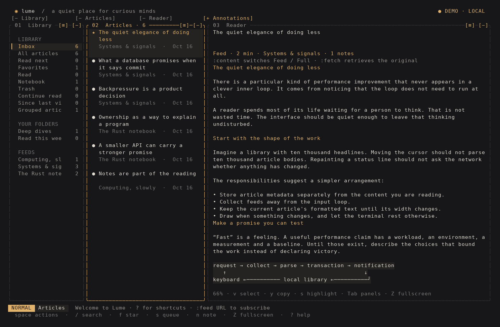
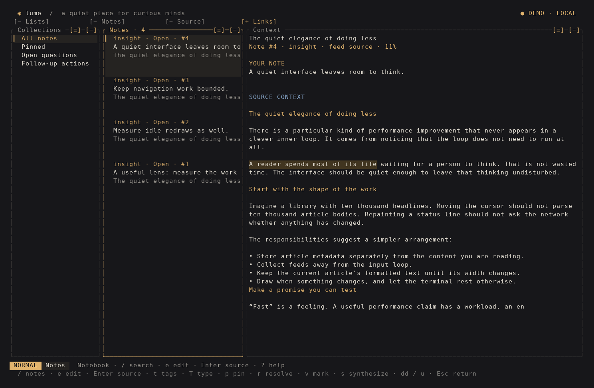
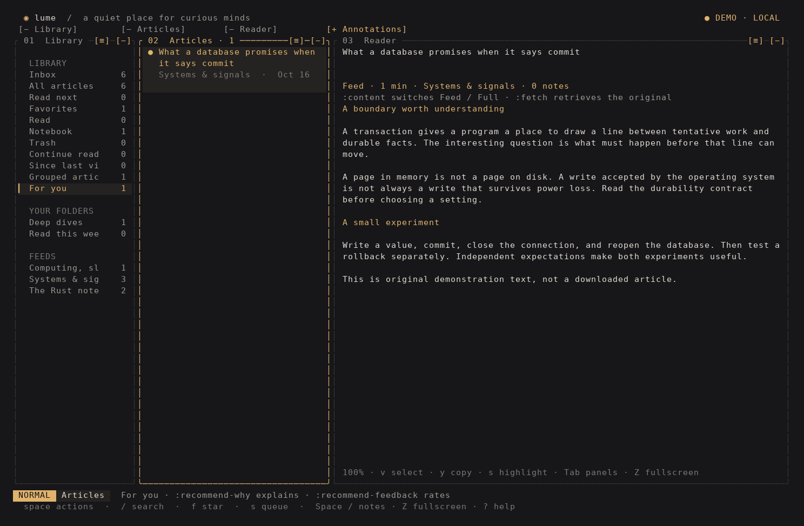
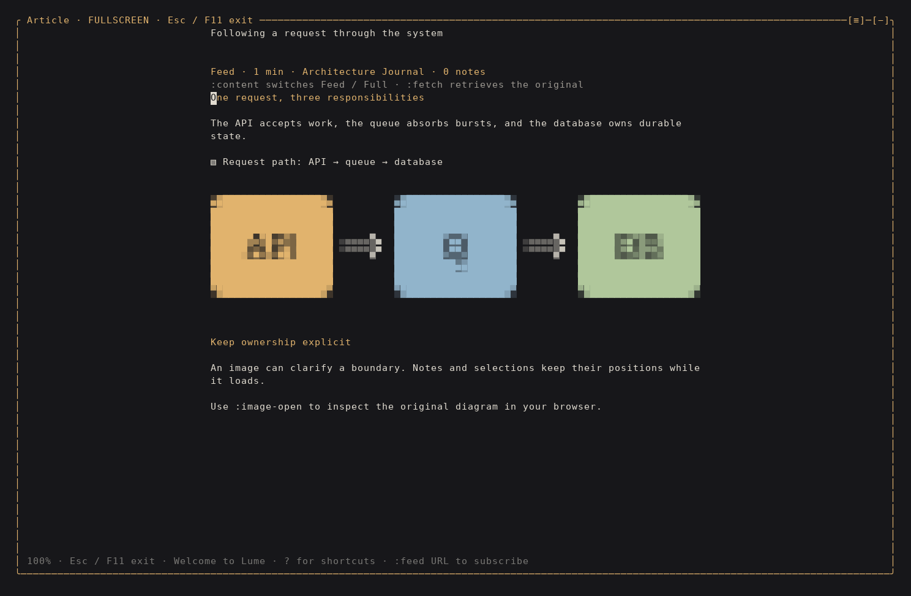

# Lume

A quiet place for curious minds. An independent RSS, Atom and JSON Feed
reader in Rust, with a charcoal, ivory and amber terminal interface and
Vim-inspired navigation. Runs locally without an account or server.



## A notebook beside your reading

`Space n` opens **Collections → Notes → Context**; `Space /` searches notes
from any panel. Search targets individual annotations, with highlighted FTS5
snippets and filters for article, source, author, tags, type, status and dates.
For example, `:notes type:question status:open tag:consensus` finds open study
questions. `:note-collection Distributed systems` saves the current query as
an automatically updated collection. `:note-recent` restores recent searches.

Use `j/k`, `gg/G` and `Ctrl-d/u` to navigate, `e` to edit, `t` for tags, `T` for
types, `p` to pin and `r` to resolve/reopen. `dd` deletes the selected note and
`u` restores it with its tags, references and study cards. `Enter` opens its
exact source; `Ctrl-o` returns to the previous Notebook search. Mouse selection,
wheel scrolling and the existing `Ctrl-w` layout controls work in this workspace.
Its arrangement persists separately from the reading layout. Open the source
before using article actions; these cannot mutate a hidden library selection.

Type `[[` inside a note to choose a stable `[[Note-ID]]` reference. `b` opens
references and backlinks; following one retains the previous query in history.
Mark up to 20 notes with `v`, then `s` builds an editable synthesis with source
citations. `y` copies the complete note; `Y` copies its quotation.

The editor preserves Markdown indentation, tabs and trailing newlines through
paste, save and yank. It supports `/PATTERN`, `n/N`, `:template question` (also study,
definition, todo and synthesis), `:w`, `:wq` and `:wqa`. Interrupted buffers
remain available through `:drafts`; new editors cannot overwrite them.
`:note-history` previews old/current text before restoring one of the last
100 versions. `:note-reanchor` previews a new Reader selection before repairing
an annotation's source range. Creating notes requires Reader focus; existing
notes can be edited from the Notebook or Annotations panel.

`:cards [NOTE_QUERY]` hides answers until revealed, then offers explicit
Again/Hard/Good/Easy intervals of 1/3/7/14 days. Postpone changes the date without
counting a review. `:review [NOTE_QUERY]` reviews due notes.
`:export-note-files DIRECTORY` writes incremental `Note-ID.md` files for tools
such as Obsidian, retaining quotes, tags, wikilinks and backlinks. Locally edited
files become conflicts and remain untouched; deleting a note never deletes
an exported file.



## A local For you shortlist



`Space R` or `:recommendations` opens up to 100 recommendations from your
cached library. Bundled, editable interests cover infrastructure, systems,
security and AI. No model, GPU, hosted account or additional service is needed.

```text
:interest Kernel networking | 9 | conntrack OR cilium OR XDP
:recommend-exclude title:webinar OR title:sponsored
:recommend-settings minutes 20
:recommend-settings source 12 5
:recommend-why
:recommend-feedback useful
```

`:recommend-profile` shows interests and settings. Priority is 1–10;
source preference is -10..10 (zero clears). `minutes off` removes the time
limit; `read on/off` includes/excludes articles marked read.
`:interest-remove NAME` removes a topic; an empty profile stays empty.
`:recommend-feedback not-interested`, `too-basic` or `too-advanced` hides an
article and its canonical duplicates. `clear` removes its rating. Useful and
not-interested feedback adjust matching interest affinities within bounds;
difficulty feedback does not reject the subject. Opening an article never
counts as approval. `:similar` filters For you by up to four strongest shared
interest rules. `:help recommendations` explains the complete workflow.

Explanations identify matching interests, title matches and whether the
available evidence is feed content, a summary, references or a cached full
article. Code and announcement wording are observed signals, not verified
quality or difficulty. Matching uses explicit vocabulary and FTS5 prefixes/
phrases; it does not provide neural semantic understanding. Relevance and
technical correctness remain different questions.

New/changed publisher text is processed in durable batches of 64 on a bounded
worker; state edits reuse cached evidence. The published shortlist is stored
in SQLite, so navigating never runs classification. A 512-candidate pool bounds
in-memory diversification; this is a shortlist, not an exhaustive relevance
ordering. Initial indexing can take time. No recommendation request downloads
an article, sends notes elsewhere or requires connectivity.

## Start reading

```sh
make install
lume starter
lume
```

`make install` builds the release executable and installs it in
`~/.local/bin/lume`. Add `~/.local/bin` to your `PATH` if needed. Installation
uses Python 3 with its standard-library SQLite module; running Lume requires
neither Python nor the source checkout.

`lume starter` installs **98 real subscriptions and 46 smart lists**
in `~/.local/lume/library.sqlite3`. Topics cover Kubernetes, architecture,
microservices, authentication, databases, pipelines, infrastructure,
**Security**, **Artificial intelligence**, developer platforms, Linux kernels,
eBPF and cloud-native networking. The AI selection includes
transformers, LLMs, training, fine-tuning, retrieval, inference, evaluation,
agents and multimodal models. Source collections for Platform engineering,
Kernel and systems, Networks and dataplanes, and DevOps and delivery include
future posts without keyword matching. Focused searches cover Cilium, CNI,
network policy, runtimes, Terraform, BGP, controllers and software supply chains.
See the [source guide](docs/reading-sources.md).

Collection runs in the background on startup. Articles become available after
successful collection; feeds may provide summaries rather than full text.
Some community and announcement feeds supply only links. When you open one,
Lume retrieves the original article in the background and caches it for offline
reading. `:fetch` retrieves a full page manually, including summary-only entries.
`:content` switches between `Feed` and `Full article`; the feed and discussion
link remain available. The article worker is independent of feed collection.
See the [full-article preview](docs/preview-full-article.png).
Use `lume sync` to collect from the CLI or `lume --offline` to read the
cache. Reinstalling the selection preserves articles, notes, favorites,
folders and custom search criteria. Historical bundled labels upgrade to
English while retaining their identities and active views.

To try the interface with original fictional articles in a separate database:

```sh
cargo run --locked -- --demo
```

Demo edits persist in a separate `demo.sqlite3`, and fictional feeds are never
collected. Running `starter` again re-enables bundled subscriptions that were
previously archived. Updating the executable with `make install` does not
reinstall subscriptions or reset personal data.

Subscribe to other sources using the installed executable:

```sh
lume add https://blog.rust-lang.org/feed.xml
lume sync
lume
```

Inside the TUI, use `:feed URL` or Space d to discover advertised feeds on a
page. Discovery presents choices before subscribing. Press `r` to refresh.
`--offline` suppresses startup collection, keeping the cache available.

## Read, think and organize

- Headings, emphasis, quotations, lists, keyboard-accessible links and
  multi-language code colors. Images, scripts and CSS are not executed.
- Fullscreen articles, a centered Zen mode and persistent panel preferences.
  Source-byte anchors preserve the current passage through reflow.
- Favorites, multiple personal folders per article and a Read next queue.
  The automatic **Read** folder follows the saved read state.
- Discoverable `:` commands, Tab completion, a command palette and an article
  finder with previews.
- A high-contrast ivory reader cursor, precise visual selections and terminal
  clipboard yanks. The cursor stays distinct from amber text selections.
- Recoverable article deletion with a Trash destination, restore and undo.
- Private comments and persistent passage highlights, including original
  quotations when publishers change their text. A Notebook gathers them.
- Passage markers with mouse previews and direct editing. `n` annotates the
  current row when no reader search is active; `:annotate` also works during
  search. `dd` deletes the note under the cursor or selected in Annotations;
  `u` restores it. Enter edits a reader note; `:note` creates a general note.
  See the [actual note preview](docs/preview-notes.png).
- FTS5 search across titles, sources, authors, bodies, quotations and notes.
  Boolean queries support OR, AND, NOT, phrases and field/date/duration filters.
- Smart lists combine text, source membership, unread/favorite flags and
  maximum publication age. Their text field accepts the same boolean queries;
  additional filled criteria must all match.
- Persistent undo for personal annotations, folders, memberships, favorites,
  read state and queue changes, retaining up to 256 operations.
- OPML exchange and Markdown export of articles or the entire Notebook.
  Exports create new files and preserve existing destinations.
- Database pagination keeps older articles accessible in every destination.

| Key | Action |
| --- | --- |
| h j k l, arrows | Move the reader cursor; navigate in other panes |
| Tab, Shift-Tab | Switch expanded panes in saved order |
| Ctrl-w h/l, H/L | Focus previous/next pane; move it left/right |
| Alt-Left/Right | Move focused pane directly (also Ctrl-w, then Left/Right) |
| Ctrl-w +/-, c, a | Resize; collapse focused pane; expand annotations |
| Space v/t, :reader, :annotations | Toggle reader / article notes |
| Enter | Read an article and mark it read |
| gg, G | First/last position, including across article pages |
| Ctrl-d, Ctrl-u | Half-page down/up |
| / | Search inside the reader; search the destination in other panels |
| : | Discover commands, filter suggestions and complete with Tab |
| Ctrl-p | Command and destination palette with previews |
| Space | Contextual actions |
| Space f | Find any article with a preview |
| F11, Z | Toggle fullscreen; Esc restores panels |
| Space z, :zen | Toggle centered Zen mode |
| zh, zl, zH, zL | Scroll code horizontally by cells or half-widths |
| H, M, L | Top, middle or bottom of the visible reader |
| :favorite, m, s | Toggle favorite, read state and queue membership |
| a, :organize | Organize folders; in visual mode use :organize |
| Ctrl-n in folder picker | Create and select a folder from the search text |
| :folder NAME, d | Create a folder; remove article from the current folder |
| D, Delete | Move the current article to Trash; u undoes |
| w/W, b/B, e/E, ge/gE | Word/WORD start and end motions |
| 0, ^, $, g_ | Row start, first nonblank, end, last nonblank |
| 5j, 3W, 24G | Counted motions and numbered display rows |
| fX/FX, tX/TX, ;/, | Character find, till, repeat and reverse |
| n/N | Next/previous reader search match |
| v, V | Select characters or complete visual lines |
| y | Yank the selection to the terminal clipboard |
| s during selection | Save a highlight immediately |
| n during selection | Annotate the passage; Ctrl-s saves |
| :note, :edit-note | New comment; edit selected annotation |
| [, ] | Select an annotation |
| u | Undo a personal change |
| o, Space o | Open the original; choose an article link |
| :fetch / :content | Retrieve a full article / switch Feed and Full |
| ?, :help layout, :help vim | Scrollable field guide with section bookmarks |
| q | Save session and quit |

The compact header keeps identity and pane controls; the redundant destination
breadcrumb has been removed to give reading one more terminal row.

`:help layout` opens the [layout field guide](docs/preview-help.png).
`:help vim` jumps directly to reader motions and selection instructions.

Every panel can collapse: **Library, Articles, Reader and Annotations**.
Click its `[−]` title button or use `Ctrl-w c`; the top `[+]` buttons reopen
panels. All four may be collapsed. Tab then restores Reader. Hold the `[≡]`
corner grip beside `[−]` and drag onto another pane or top tab to reorder.
The panel follows the pointer horizontally and vertically while the grip is
held, with the rest of the workspace temporarily darkened. Neighboring panels
slide aside to open the insertion slot; moving back reverses the preview.
The panel's leading edge opens space before the grip reaches its neighbor;
separate entry and retreat margins keep border movement stable.
The held surface matches the dim canvas, keeping its text and rounded outline
bright without a rectangular background plate or cut-out corner cells.
The destination tab turns blue; even collapsed tabs accept
drops. At terminal edges the floating picture is clipped. On release, a short
160 ms transition settles it into place, or returns it if no target was chosen.
New input or resizing interrupts the transition immediately. The article is
captured once for drawing, without reflow or SQL on every motion frame.
Titles also work as move handles. Drag a divider to resize adjacent panels.
Release saves the layout; Esc cancels a resize preview. Order, widths,
visibility and mouse preference persist across restarts. Moves survive
background article refreshes, while Esc, focus loss or terminal resize cancel
uncommitted moves. Keyboard movement prioritizes currently visible neighbors;
it reports an edge instead of silently saving an unchanged layout. For Vim
sequences, release Ctrl-w before Shift-h/Shift-l, or use the arrow alternatives.
See the [animated drag preview](docs/preview-drag.gif). The same operations
are available through `:panel`, `:panel-focus`, `:panel-close`, `:panel-move`
and `:panel-resize`. See the [panel preview](docs/preview-annotations.png).

Custom layouts support both rows and columns. `Ctrl-w s` splits below;
`Ctrl-w v` splits right. `Ctrl-w h/j/k/l` focuses spatial neighbors and
`Ctrl-w H/J/K/L` moves panes. The prefix opens a contextual key guide;
selection mode keeps its own copy/highlight/note hints.

```
:workspace load Study
:panel-dock annotations reader below
:workspace save My study
:layout-undo
:layout-redo
:workspace load Reading
:layout-columns
```

`Reading`, `Study` and `Browse` are initial profiles. Profiles retain pane
visibility, topology, proportions, widths and reading display preferences;
the selected article, theme, keybindings and content source stay yours.
`:workspace list` lists profiles; `:workspace delete NAME` removes one.
Keyboard resize uses columns for classic layouts and percentage points for
custom splits, selecting the nearest visible seam.
Layout undo/redo retains 32 changes across restarts and is independent of `u`
for personal article edits. Drag a row's upper neighbor's bottom border to
resize it; the next pane's title buttons remain available. Esc cancels.

A grip needs two columns or one row of movement before dragging starts.
A thin blue seam marks insertion; target the first two content rows or last
three rows to dock above/below. Custom layouts also accept left/right docking.
Very wide or oversized panes use a bounded 38-column, 9-row card while held.
Size-changing drops use actual text reflow instead of stretching frozen text.

The terminal uses separate bounded workers for navigation reads, Markdown
layout, syntax, and ordered session writes. Changing lists updates selection
without waiting for the query; only the latest response can replace the page.
Progress belongs to the loaded article, never to a loading placeholder.
The status bar shows `saving…` until writes finish and keeps `SAVE ERROR`
visible after a failed write. Exit flushes admitted writes with a five-second
limit. Named profiles and layout history commit atomically. Explicit
source-bound jumps, personal mutations, catalog refresh and some exchange
operations still use synchronous storage; no hard latency bound is promised.

Mouse capture defaults on. Click an article to read, wheel the pane beneath
the pointer, or drag within Reader to select exact text. Selection stays in
the reader column even if the pointer crosses a divider; `y` yanks, `s` saves
a highlight and `n` adds a passage note. Capture depends on terminal reporting;
`:mouse status` reports observed events, while `:mouse off` restores native
terminal interaction. In Alacritty, [holding Shift bypasses mouse reporting](https://alacritty.org/config-alacritty.html#mouse),
so native terminal selection remains available. Capture is suspended around
external editors and disabled on exit. Physical Alacritty behavior has not
been qualified in this environment.

Each reported wheel event scrolls one visual row, list item or horizontal
column. Bursts preserve their exact reported distance and direction changes.
If one physical notch still moves several rows in Alacritty, merge this into
its configuration (without duplicating an existing `[scrolling]` section):

```toml
[scrolling]
multiplier = 1
```

Alacritty's [scroll multiplier defaults to three](https://alacritty.org/config-alacritty.html#scrolling).
Terminal mouse reports do not identify the original hardware notch, so Lume
does not discard valid events to guess its boundaries.

`:annotations` opens notes for the current article in source order, with quote
and note previews. `j/k` or wheel selects; Enter or click jumps to the passage.
`e` edits, `n` creates a general note and `D`/Delete removes the selected note;
`u` restores it. Alternate Feed/Full sources, unplaced quotations and general
notes are labeled separately. Ambiguous passages remain saved without a
guessed jump. This article-local panel complements the searchable Notebook.

Editors support cursor movement, Shift-arrow selections, internal cut/copy,
Ctrl-z/Ctrl-r history and paste as text. They start in **INSERT**: Enter inserts
a line and Esc enters **NORMAL**, preserving the draft. Normal mode supports
`hjkl`, `w/b/e`, `0/$`, `G`, `i/a/I/A`, `o/O`, `x` and `u`. Press `:` there to
open a command line separate from the note text:

| Editor command | Effect |
| --- | --- |
| `:w`, `:write`, `:wa`, `:wall` | Save and keep the editor open |
| `:wq`, `:x`, `:xit`, `:exit`, `ZZ` | Save and return to reading |
| `:wqa`, `:wqall`, `:xa`, `:xall` | Save draft and session, then quit Lume |
| `:q`, `:quit` | Close a clean draft; refuse unsaved changes |
| `:qa`, `:qall` | Quit Lume only when the draft is clean |
| `:q!`, `:quit!`, `ZQ` | Discard draft and close the editor |
| `:qa!`, `:qall!` | Discard draft, save session and quit Lume |

After `:w`, `i` resumes insertion. The `[+]` title marker indicates unsaved
changes. Repeated writes update the same note/card and retain passage quotes
and review schedules. Failed writes retain the draft and command line.
Write commands accept `!` without bypassing storage validation. Lume has one
draft buffer; filenames, ranges and shell commands are unsupported.
Outside a note editor, `:w`/`:wa` save the session and `:wq`/`:wqa`/`:x` quit
after saving it. General command completion advertises these operations.

Ctrl-s saves and closes from any editor layer. Ctrl-e opens `$VISUAL` or
`$EDITOR`, then returns
the result for review. Editor arguments are parsed without shell evaluation.
Pasted or inserted command text remains literal until an explicit normal-mode
command is entered. Ctrl-c retains the application's immediate exit behavior.
Outside the reader, `f` toggles favorites, `e` edits existing notes, `N`
creates a folder and `z` toggles Zen. Reader `f`, `e`, `N` and `z` belong
to Vim motions. See `:help vim` for paragraphs, brackets, visual word objects,
viewport positioning and jump history. This is read-only navigation; publisher
text is never edited with Vim operators.
Reader `h`/`l` and Left/Right cross display-row boundaries, including soft
wraps and blank rows. Counts and visual selections follow the same movement.
Reader `I` and `A` move to the first nonblank and row end. `g^` also moves
to the first nonblank; `20|` targets terminal column 20, respecting tabs and
Unicode cell widths. Backspace moves one grapheme left. Ctrl-Left/Right move
between words; Ctrl-Home/End jump to the first/last display row. These bindings
remain navigation commands during visual selection and never edit article text.

Personal folders are flat article collections. An article can belong to
several folders and remain a favorite. The `a` picker keeps membership changes
pending until Enter. Ctrl-n creates a folder immediately; Esc discards pending
memberships but keeps that empty folder. Deleting a folder preserves articles
and notes; `u` restores it. Use `N` to create a folder with an empty cache.

The automatic Read folder queries durable read state without duplicating
articles. Marking an article unread removes it from Read. Opening an Inbox
article keeps it visible while reading, and the read count updates immediately.
Notes, favorites and personal folders remain independent of read state.

Use `D`, Delete or `:delete-article` to move an article to **Trash**.
`:trash` opens deleted posts; `:restore-article` restores the selected one.
Both transitions support `u`, including after restart. Article content, notes,
favorites, queue state and folder associations remain saved for recovery.
Normal destinations, searches and Notebook exports exclude Trash. An explicit
article export still works there. Feed refreshes preserve deletion state.
The command palette captures the target article when opened, so a background
reload cannot redirect a pending deletion to another post. Reported keyboard
repeat events cannot repeatedly delete subsequent articles. In draft editors,
Delete continues to edit text.

Typing `:` opens the [command menu](docs/preview-commands.png). Type to filter;
use arrows or Ctrl-n/Ctrl-p to select, and Tab to complete. Enter executes a
complete command or completes a prefix. Required arguments remain editable.
Esc closes the menu. The Ctrl-p palette combines actions and destinations.

Fullscreen centers text in an 80-column block and preserves the underlying
panel preferences. `:fullscreen-width 100` changes its width (40–140 columns),
independently of `:width` in the panel layout. Smaller terminals clamp the block
to the available space. It persists across sessions. Close note editors with
`:wq` or `:q!`; Esc closes help or selection, then restores panels. See the
[fullscreen preview](docs/preview-fullscreen.png).

Code highlighting supports **C, C++, Rust, Terraform/HCL, JavaScript,
TypeScript, Go, Java, Python, Bash, SQL, YAML, JSON, HTML and CSS** without
additional downloads. Markdown fences, HTML `language-*`, `lang-*`,
`highlight-source-*`, `data-lang` and `data-language` identify the language.
Aliases include `rs`, `tf`, `hcl`, `js`, `ts`, `golang`, `sh` and `yml`.
Indentation is preserved. Interactive rendering immediately displays plain
code; a single worker adds syntax colors without blocking input. Exact
code/language cache keys keep colors consistent after navigation and refresh.
Unknown languages, oversized blocks and worker failures leave readable plain
code. Cached articles that lost language metadata need refreshing.
See the [multi-language preview](docs/preview-highlighting.png).

The reader paints a steady ivory block with a dark, bold character. It keeps
the terminal's hardware cursor hidden while reading, avoiding a second block
that can invert the same cell and cancel its contrast in Alacritty. The shell
cursor is restored on exit. See the [cursor preview](docs/preview-cursor.png).

In the reader, use `v` to select an exact passage and `y` to copy readable text
without Markdown delimiters or artificial wrapping. `V` selects visual lines.
During selection, `s` saves a visible highlight and `n` opens a passage note.
Then `:edit-note` edits it. Highlights persist in the article and Notebook; `u` undoes
creation and `:delete-comment` removes the selected annotation. Cursor and
selections respect combining marks, wide characters and emoji. See the
[selection preview](docs/preview-selection.png).

Clipboard writes use OSC 52, which Alacritty allows by default. Terminal
settings can reject the request; Lume reports sending rather than assuming
an acknowledgment. Yanks accept at most 64 KiB; highlights accept 8 KiB of
original source. Saved quotations retain normalized Markdown bytes. If a
publisher changes the article, a unique match relocates the highlight;
ambiguous quotations remain in the Notebook without coloring another passage.

## Commands and files

See the [capability audit](docs/feature-audit.md) for requested features,
their regression coverage and current boundaries. Performance measurements
and qualification results are recorded in [validation](docs/validation.md).

### Reader tools

`/` searches inside the article when the reader has focus; in the headlines or
library it searches the destination. Reader search is literal and case-sensitive,
with underlined matches. It excludes generated notices and private comments.
Use `n/N` or `:find-next` / `:find-prev` to move between matches. `:toc` opens a heading
outline; `:jump-back` and `:jump-forward` restore source-bound passages across
reflow. Changed passages relocate only when their saved context has one match.

| Command | Action |
| --- | --- |
| :find TEXT | Find exact text within this article |
| :find-next / :find-prev | Next/previous match, wrapping at the end |
| :toc | Choose a heading |
| :highlights | Browse passage highlights; accepts a text filter |
| :jump-back / :jump-forward | Navigate the bounded passage history |
| :copy-code | Yank the entire code block under the cursor |
| :tables | Inspect aligned tables without wrapping |

The table inspector uses j/k for rows, h/l for horizontal movement and Esc to
close. HTML tables retain cells, escaped pipes and validated links. Tables over
64 columns fall back to unaligned text. Both aligned and unaligned previews
are capped at 1 MiB, including the notice; the original article stays intact. Structural indexing stops at 50,000 parser
events without removing article text. Code copies keep indentation and omit
Markdown fences; the existing 64 KiB clipboard limit applies.

### Article images



The Reader displays PNG, JPEG, WebP, GIF (first frame) and SVG references from
HTML or Markdown. HTML `img` references, including `data-src` lazy images, are
preserved during normalization. Previously cached articles that lost image
references need a fresh feed collection or `:fetch` for the full article.

**Foot on native Wayland:** run `lume` normally. Inline images and the zoom
inspector use Sixel pixels directly in the terminal. No image helper, X11
window, XWayland launcher or external display process is required.

The image worker fits each inline image once, then encodes one Sixel strip per
terminal row with the pinned ratatui-image library. Scrolling copies only the
visible strips, preserving source coordinates when either edge is clipped.
Decoding, SVG rendering, resizing and quantization never occur in drawing.
Sixel uses a limited color palette; it preserves spatial detail but can change
photographic gradients compared with the original image.

Click an image/caption, press **Enter** on it or use `:image` to open the larger
inspector. `+`/`-` zoom from source bytes, `hjkl`/arrows and the wheel pan,
`0` fits, `o` opens the original and `Esc` returns without changing the reader
selection, position or layout. SVG geometry is re-rendered at the requested
scale; raster zoom crops the original before Lanczos3 resizing. GIFs and SVGs
are static previews. Inline SVG markup and nested resources are not rendered.

Foot is detected through `TERM=foot`, `TERM=foot-extra` or `TERM_PROGRAM=foot`.
iTerm2 and WezTerm retain native inspector support. Other terminals and
multiplexers default to portable truecolor Unicode halfblocks. The command
`:image-protocol auto|blocks|sixel|iterm2` selects the session backend; only force
a native protocol supported by your terminal. `b` returns the inspector to
blocks. OS window reports supply cell dimensions, falling back to 10×20 when
unavailable. No competing stdin capability reader is started.

Native inline images remain visible during keyboard and mouse text selection.
Menus (including the Ctrl-w guide), note previews and panel movement suppress
them so pixels cannot cover controls. They are painted after theming and
pane-picture capture. Foot frames
use synchronized terminal updates so intermediate erases and pixel writes are
presented together. This bounds visible update stages; physical display latency
still depends on the terminal and compositor.

| Command | Action |
| --- | --- |
| :images | Show the current loading policy |
| :images off / :images on | Pause/resume new loads; keep ready previews |
| :images retry | Retry failed visible images |
| :image / Enter on image | Open the source-based zoom/pan inspector |
| :image-protocol | Show or select the image graphics backend |
| :image-open | Open the image under the Reader cursor |

Only visible images are requested, on one background worker. Fixed slots
prevent late results from shifting text, selections or notes. Decoding and
encoding happen outside input/drawing. At most 24 prepared thumbnails are
retained, including at most two detailed inspector encodings. Each inspector
surface is limited to four million pixels; zoom never creates a complete
enlarged image canvas. Cached inline Sixel strips share a 32 MiB budget, with
an 8 MiB limit per encoding. At most four visible Reader images use native
pixels simultaneously; additional images retain cell previews. Each strip uses
the encoder's quantization for its own source rows. No publisher path is passed
to an external display process.
Raw image files use a disposable `images/` cache alongside your library,
capped at 64 MiB and 128 files, evicting oldest writes. `--offline`
reads that cache without downloading misses. A failed image leaves the article
readable, with an inline reason and an explicit retry command.
Cached bytes are reused by URL until eviction; publisher ETags are not
revalidated for image resources in this version.

Raster downloads are capped at 8 MiB, 8192 pixels per dimension and 8 million
pixels total. SVGs are capped at 512 KiB and 5,000 XML nodes; DTDs, scripts,
external files and nested image loads are disabled. SVG text reuses one fallback
font, loaded only when needed and limited to a 4 MiB TTF/OTF. Common OS font
paths are checked; set `LUME_SVG_FONT=/absolute/path/font.ttf` for another font.
SVG without text needs no font. Decoder limits are not an OS memory sandbox.
Built-in previews need no external renderer. The optional Überzug++ path uses
its separately installed foreground helper; images require no server.

### Source rules and health

Use `:extract-preview article.post-content` to test a CSS container on the
selected article. The selector must match exactly one element. A scrollable
**unsaved** preview appears; Enter saves the captured source rule and preview
cache together, while Esc discards it. A background result waits for an active
draft or visual selection. A changed URL, deleted article or concurrently
changed rule prevents confirmation. `:extract-preview auto` previews Readability
before restoring automatic extraction. No rule is saved after a failed preview.

The reader distinguishes **Feed**, **Summary from feed** and **Full article
cached**. Short extractions show a warning; likely consent/browser obstructions
are rejected, preserving the previous cache. These checks are heuristics, not a
guarantee that an article is complete. Previously cached entries retain Feed
provenance until a fresh publisher response supplies their exact origin.

`:source-health` lists active sources with last attempt/success, error,
consecutive failures, effective retry deadline, URL and active selector. New
sources show NEW; a hostname cooldown shows WAITING before their first attempt. Collection uses four
download lanes and one SQLite writer. Subscription hostnames never share active
lanes; requests to the same hostname start at least 500 ms apart. Retry-After
seconds/HTTP dates survive restart by hostname, including newly subscribed
feeds on that host. Ordinary failure backoff remains specific to each feed. Progress
arrives incrementally. A successful source is ready on the next explicit or
startup refresh; there is no periodic background daemon.

### Boolean search and saved views

The live library search and smart-list text field share one bounded grammar:
NOT binds before AND, which binds before OR. Adjacent terms imply AND; bare
words match FTS prefixes and quoted text matches exact token phrases.

```text
(topic:kubernetes OR topic:ebpf) AND is:unread AND NOT title:webinar
author:"Brendan Gregg" AND after:2026-10-01 AND before:2026-11-01
domain:kernel.org AND minutes:1..20
tag:networking AND is:favorite
```

Fields are `title`, `author`, `source`, `body`, `notes`, `domain`, `topic`, `tag`,
`highlight-tag`, `after`, `before`, `minutes` and `is`. `tag` matches article
tags; `highlight-tag` matches annotation tags. `topic` searches full text; it does not
infer a topic label. Dates are UTC: `after` includes the start day and `before`
excludes its day. Domain filtering accepts an exact lowercase hostname and matches HTTP(S)
articles on any valid port, without matching subdomains or hostname suffixes.
Duration uses the best available cached text at 220 words per minute.
States include unread, read, favorite, queued, annotated and cached.

Tab completes a final field/operator prefix in live search. Ctrl-Space does the
same in the smart form's query field; Tab still moves between form fields.
`:explain-search` shows the current query and saved-list criteria; an argument
explains that query instead. Invalid syntax, dates and fields are errors,
including when saving a smart list. Queries accept at most 16 KiB, 256 tokens and
16 nested groups/negations; saved smart-list text retains its 4 KiB limit.

### Personal organization and study

| Command | Action |
| --- | --- |
| :pin / :move-up / :move-down | Pin and reorder destinations |
| :collapse feeds\|lists\|folders\|pinned | Fold/unfold a sidebar section |
| :select-article / :select-page | Capture identities for a batch |
| :clear-selection | Discard the batch selection |
| :bulk read\|unread\|favorite\|unfavorite\|queue\|unqueue | Apply one atomic batch |
| :bulk folder NAME / :bulk tag NAME | Add an existing folder or independent tag |
| :tags NAME… / :tags clear | Replace/clear independent article tags |
| :highlight-tags NAME… / :highlight-tags clear | Replace/clear annotation tags |
| :related / :grouped | Browse occurrences / one representative per URL |
| :continue / :since-last-visit | Saved reading positions / newly collected entries |
| :review / :review-in DAYS | Review due highlights / choose the next interval |
| :card / :cards | Write a user-authored card / recall due questions |
| :link-note ARTICLE_ID / :note-links | Link/browse related readings for a note |
| :export-notes DIRECTORY | Reconcile notes into Markdown/Obsidian files |

Batch selection retains up to 1,000 identities across pages. One undo restores
the entire batch; any missing/trashed target rolls it back. Tags are independent
of folders, and annotation tags never implicitly tag the article. Empty `:tags`
or `:highlight-tags` inspects existing tags. Collapsed headers expand with Enter.

URL grouping removes fragments and known tracking keys, keeps meaningful query
parameters, and never deletes or merges publisher entries. Grouping happens
after search and chooses the newest publication, breaking ties by article ID.
Each occurrence keeps its original URL fragment, discussion links, notes and state.
Continue reading means a saved nonzero reading anchor; it does not infer that
opening an article proves completion. Since last visit uses collection time,
with a boundary recorded only when leaving a terminal session.

Cards belong to a selected annotation (`[` / `]`) and use `Question | Answer`.
Both sides are your own text; Ctrl-s saves the multiline editor. Questions are
limited to 1 KiB, answers to 8 KiB, with 16 cards per annotation. Revealing an
answer does not review it; Enter on the answer schedules seven days, while Esc
leaves it due. Passage intervals can be chosen explicitly from 1–3,650 days.
There is no inferred recall score. A changed note, completed concurrent review
or move to Trash invalidates an open review preview without recording a review. Annotation deletion undo restores its tags,
links, cards and review dates as well as its original quote.

Incremental exports use stable `Lume-ID.md` filenames. Unchanged files are not
rewritten; local edits, symlinks and unowned destinations are preserved as
reported conflicts. Managed files are limited to 1 MiB. Removed/trashed notes do
not delete exported files automatically. The directory lock prevents concurrent
Lume exports; after a process crash, inspect `.lume-export.lock` before removing
that stale lock. The same operation is available as `lume export-notes DIRECTORY`.

### Visual preferences and keys

`:settings` previews themes, widths, compact mode and panel visibility. Up/down
selects a field, left/right changes it, Enter saves, and Esc restores the prior
preferences. Exiting with Ctrl-c also discards an unconfirmed preview.
`:theme lume|nord|gruvbox` selects a dark palette directly; Lume's
charcoal/ivory/amber palette remains the default. Existing width commands also
resize panels. No patched font is required.

`:bind ctrl-t toc` maps a normal-mode key to an available command;
`:unbind ctrl-t` removes it. Characters, arrows, f1–f12 and named keys such as
`space`, `enter`, `tab` and `esc` accept optional `ctrl-`/`alt-` prefixes.
Uppercase characters name shifted letters. Ctrl-c remains reserved for exit.
Editors keep their insertion controls; key repeats cannot repeat bound actions.
Preferences are stored with the local workspace and survive restart.

Full article fetching defaults to `missing`: it starts when you open an entry
without independent article text. `:fetch-policy always` also fetches uncached
entries containing summaries; `:fetch-policy manual` disables automatic fetching
for that subscription. `:fetch-policy missing` restores the default. It applies
to the selected subscription or the selected article's source. Explicit
`:fetch` can retry immediately; automatic attempts wait 15 minutes after a
failure. Merely moving through headlines does not fetch every article.

Successful caches reopen without a network request. `:content feed` and
`:content full` choose a source explicitly; the preference survives restart.
Both sources retain independent reading positions. Failed downloads preserve
the last successful cache and show their reason. Private passage notes retain
their source, revision and original quote. A completion waits while a draft
or visual selection is active. After changed extraction, ambiguous quotes are
kept in the notes without painting a different occurrence.

| TUI command | Action |
| --- | --- |
| :fetch | Retrieve/cache the selected article from its original URL |
| :content / :content feed / :content full | Toggle or select the body source |
| :fetch-policy missing\|always\|manual | Set automatic fetching for this source |
| :feed URL / :discover URL | Subscribe / discover advertised feeds |
| :unfeed | Archive a subscription, keeping cache and notes |
| :folder NAME / :folders | Create a folder / browse folders |
| :save NAME / :organize | Create/save to a folder / choose several folders |
| :favorites / :favorite | Open favorites / toggle the current favorite |
| :mark-read / :mark-unread | Set read state explicitly |
| :read | Open the automatic Read folder |
| :delete-article / :delete-post | Move the selected article to Trash |
| :trash | Browse deleted articles |
| :restore-article / :restore | Restore the selected article from Trash |
| :rename NAME / :delete-folder | Rename / remove the selected folder |
| :delete-comment | Remove the selected annotation |
| :smart / :delete-smart | Create/edit / remove a smart list |
| :queue / :notebook | Open Read next / annotations |
| :fullscreen / :fs | Toggle fullscreen |
| :zen / :sidebar / :articles / :reader / :annotations | Change panel visibility |
| :panel-focus NAME / :panel-close | Expand/focus or collapse a pane |
| :panel-move left\|right / :panel-resize +4 | Reorder / resize focused pane |
| :mouse on\|off\|status | Capture preference and terminal-event status |
| :compact | Change headline density |
| :width 82 | Reading width: 40–140 columns |
| :fullscreen-width 80 | Centered fullscreen width: 40–140 columns |
| :sidebar-width 23 | Sidebar width: 16–48 columns |
| :articles-width 36 | Headlines width: 24–80 columns |
| :import PATH | Import OPML |
| :export PATH | Export the article and notes to Markdown |
| :export-notebook PATH | Export all annotations |
| :export-opml PATH | Export subscriptions |
| :undo / :refresh / :q | Undo / collect / quit |

Aliases include `:list`, `:delete-list`, `:delete`, `:restore-post`, `:q` and `:r`. Smart-list forms use
Tab to advance, Space to toggle and Ctrl-s to save. Sources accept an exact
name, URL or numeric ID; duplicate names require a URL. Source-group lists
retain their membership when editing other criteria. Smart-list changes are
not part of undo history.

The CLI also supports `fetch ARTICLE_ID`, `feeds`, `discover URL`, `import PATH`, `search TEXT`,
`export ARTICLE_ID PATH`, `export-notebook PATH`, `export-opml PATH` and
`undo`. OPML import validates all URLs before saving and avoids duplicate
subscriptions. Nested OPML groups do not become article folders. Private
annotations are never included in OPML export.

## Keyboard response

Lume detects and enables the extended keyboard protocol for the session.
Alacritty 0.15.1 supports this negotiation. The previous terminal mode is
restored on exit and while an external editor runs.

Release events cancel pending autorepeats. Separate taps, editor text and
later keys retain their order. Navigation combines adjacent repeats and loads
only the final article. Terminals without release events cannot report the
physical instant a key is released; they still receive batched movement.
An already-running database, reflow or drawing operation finishes normally.

## Data and limits

The default database is `~/.local/lume/library.sqlite3`, independent of the
working directory or executable location. Directory selection follows
`--data-dir PATH`, then `LUME_DATA_DIR`, then `$HOME/.local/lume`:

```sh
lume --data-dir /mnt/reading
LUME_DATA_DIR=/mnt/reading lume sync
export LUME_DATA_DIR=/mnt/reading
make install
lume
```

`--database PATH` selects an exact SQLite file and overrides `LUME_DATA_DIR`.
It cannot combine with `--data-dir` or `--demo`. Demo mode uses `demo.sqlite3`
inside the chosen directory. Empty directory values fail explicitly. Explicit
relative paths resolve against the caller's working directory; use absolute
paths for a fixed custom location. New data directories/databases use Unix
permissions 0700/0600. `$XDG_DATA_HOME` is only a legacy migration source.

When the destination library does not exist, `make install` looks for a legacy
library in this checkout's `.local/library.sqlite3`,
`~/.local/share/lume/library.sqlite3` or `$XDG_DATA_HOME/lume/library.sqlite3`.
It copies a committed SQLite snapshot, including committed WAL content, and
keeps the original. Existing destination libraries are never overwritten or
merged. If several different legacy libraries exist, choose explicitly:

```sh
make install MIGRATE_FROM=/absolute/path/to/library.sqlite3
```

`PREFIX=/path` changes the executable/notices installation prefix.
`DATA_DIR=/path` changes the installer's library destination; use the same
`LUME_DATA_DIR` or `--data-dir` at runtime. `PREFIX` defaults to `~/.local`;
`DATA_DIR` defaults to `LUME_DATA_DIR` or `~/.local/lume`. Neither override
compiles a custom default into the executable. Retained license notices are
installed under `PREFIX/share/lume/licenses`.

Migrations preserve existing personal data and publisher content. Refinery
owns immutable migration versions/checksums. For backups, close Lume and copy
the complete data directory, including any WAL files, or use SQLite backup.

The reader preserves feed content and independently caches extracted article
pages. `--offline` disables all network requests. HTML extraction is best
effort: JavaScript-only pages, login/subscription gates, PDFs and unsupported
encodings may require `o` to open a browser. No JavaScript or linked assets
are executed/downloaded. Only UTF-8 HTML/XHTML is supported for full pages.
Lume does not synchronize devices or periodically collect feeds after startup.

Limits include 4 MiB per feed response/import, 2 MiB per decompressed article
page, 2,000 entries per feed, 12 seconds per HTTP request and five redirects.
The extractor checks a 20,000-element limit after DOM construction. HTML
normalization reads at most 256 KiB per article fragment; Full cache writes
reject Markdown over 512 KiB. Notes accept 16 KiB. Truncation is identified.
Parsing/highlighting do not have a hard CPU deadline. Appearance depends on
terminal color support and font; a Nerd Font is not required.

## Development

Rust stable is pinned exactly to **1.99.1**, aligned with CI. Direct dependency
versions and the transitive lockfile are pinned. The product needs no containers.

```sh
make check
make check-release
make check-http
make bench
```

`check` runs formatting, Clippy, native tests, correctness-checked workloads
and installer/preview tooling checks. `check-release` adds actual loopback HTTP
qualification and an optimized build. Socket failures are not silently skipped.
`check-http` runs that HTTP qualification independently for diagnosis.
`make bench-interaction` records three representative and three stress runs of
cached full-frame sidebar rendering, deep linewise selection and Unicode cursor
positioning. It includes resource usage and correctness assertions. These app-side
timings exclude physical terminal paint and database navigation latency.

`test-tools` checks installation, migration failures and data preservation
using isolated libraries. `bench-tools` measures correctness-checked migration
of representative and stress libraries; `bench` includes it.

For real terminal qualification, install Alacritty, xdotool, xclip and xwd
(Ubuntu packages `alacritty xdotool xclip x11-apps`). Build with `make build`,
then run `make check-alacritty` in an X11 session, or
`xvfb-run -a make check-alacritty` with Xvfb installed. The test uses a separate
demo database and configuration, checks actual keyboard/mouse input,
one-line scrolling, OSC52 clipboard output and tty restoration. It saves
screenshots and JSON results under a printed temporary directory. Missing
tools, inaccessible displays and failed assertions are errors. CI runs this
through Xvfb and retains its evidence even on failure. It does not qualify
the user's Wayland compositor or human perception of animation smoothness.

For native image qualification, install Foot, ImageMagick and Python Pillow,
then run `make check-foot` in a Wayland session after `make build`.
`FOOT_ARGS="--binary /path/to/lume --artifacts /empty/evidence/directory"`
selects the executable and evidence directory. The gate opens an owned Foot
window with an isolated library and a private PTY relay. It checks exact strip
geometry, independently decoded Sixel colors, clipping in both scroll directions,
visual selection, text clicks, click-to-inspect, source zoom, menu cleanup,
publisher text and tty restoration.
Sixel palette quantization is included in the fixture's expected colors.
Captured protocol pixels and results are retained; they do not substitute for a
compositor screenshot or a physical latency/flicker measurement. Missing tools,
inaccessible Wayland sockets and failed assertions are errors.

Earlier validation used 41 temporary dependency-source substitutions. Those
results do not qualify the normal registry build: one substituted manifest
omitted a dependency required by published `tendril` 0.5.0. Cargo.lock now
includes its required `utf-8` 0.7.6 dependency. Standard commands retain
`--locked`; normal release qualification must use published registry sources.
The current Linux registry build, local checks and real HTTP qualification pass.
HTTP checks require loopback permission in restricted environments.
Details live in [validation](docs/validation.md),
[architecture](docs/architecture.md) and [dependency policy](docs/dependency-security.md).

Full article extraction adds MIT/Apache/Zlib dependencies and explicitly
approved MPL-2.0 transitives. Their retained license texts and exact source
versions are in the [extraction notices](assets/licenses/full-article/NOTICES.md).
Distributors must include that bundle and provide MPL-covered source as
described there. Lume's own code remains MIT.

Previews come from the actual Ratatui buffer. Pillow and DejaVu Sans Mono are
optional preview tools:

```sh
cargo run --locked --example preview -- /tmp/lume-preview.json
python3 tools/render_preview.py /tmp/lume-preview.json docs/preview.png
```
