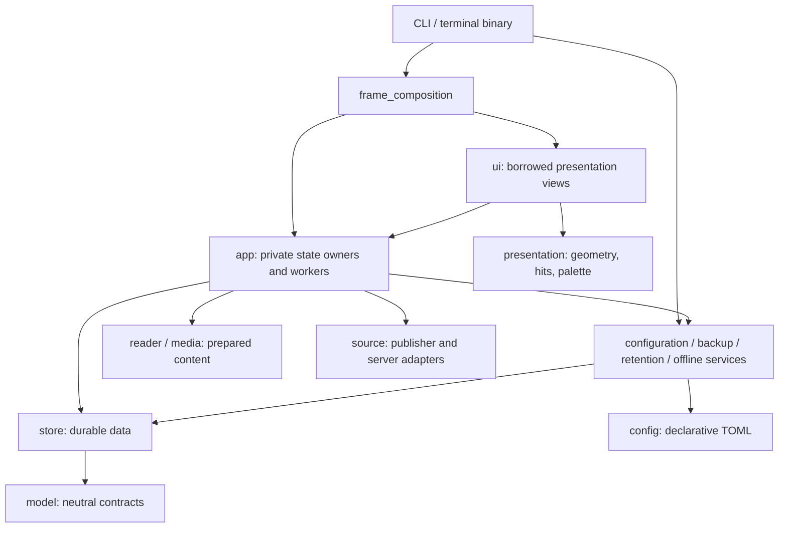

# Architecture

## At a glance

Lume is a local terminal reader with two application crates: the CLI/terminal
composition binary and the reader library. SQLite owns articles and private
reading data; declarative TOML owns preferences and source/list definitions.
New libraries have no implicit subscriptions or recommendation interests.

This is an ownership map, not every import. UI intentionally imports cached
view types from `app`; it never receives App mutation authority. App does not
depend on UI. Production root-module graphs are acyclic within each crate.

| Responsibility | Owner |
| --- | --- |
| Terminal lifetime and command-line composition | `main`, `cli`, `terminal` |
| TOML schema, validation and editing | `config` |
| Reconcile configuration with durable identities | `configuration_service` |
| Schema, transactions, publisher and personal data | `store` |
| Input workflows, focus and private state lifecycles | `app` state owners |
| Cached pane/chrome/overlay drawing | `ui`, composed by `frame_composition` |
| Source positions, Markdown and wrapping | `reader` |
| Image transport, decoding and prepared protocols | `media` |
| Feed discovery, collection and extraction | `source` |
| Local scoring and explicit source presets | `recommendation`, `catalog` |
| OPML and atomic Markdown publication | `exchange` |
| Backup, retention and offline orchestration | `backup_service`, `retention_service`, `offline_service` |
| Filesystem usage inspection and cache cleanup | `disk_usage` |

Neutral validation, URL, command and presentation contracts keep lower layers
independent of application interaction. Shared domain types belong in `model`;
services compose durable primitives rather than putting orchestration in Store.

## Data authority and configuration

Publisher refreshes update publisher fields while preserving personal flags,
folder membership, notes, highlights and deletion state. Feed text and fetched
Full text have separate identities/revisions. A publisher URL change prevents
stale extracted content from being used without deleting private annotations.

TOML definitions use portable IDs; SQLite maps them to local identities.
`configuration_service` coordinates adoption and publication. File replacement
is private and atomic, serialized with advisory locks and guarded by the last
read bytes. Three-way conflicts preserve both external edits and pending data.
SQLite and filesystem publication are separate durability boundaries; do not
pretend they form one distributed transaction. See
[configuration and recovery](configuration.md).

Store owns SQL, parameter binding, row decoding and transaction boundaries.
[SQL ownership](sql-ownership.md) covers static statements and composed queries.
Executed migration names, SQL and checksums are immutable. Publisher refresh,
restore and deletion changes need native fixtures that preserve personal data,
search indexes and identity/history contracts.

## Application state and workers

App coordinates private reader, navigation, notebook, layout, interaction and
worker state. Each owner maintains its invariants through narrow methods.
Borrowed presentation views expose cached data without allowing arbitrary
changes to workspace, selection, modes or workers. Command identities and owner
routing come from the typed registry in `command`; aliases share those routes.

Expensive reads, collection, extraction, layout and image preparation run on
bounded workers. Connections belong to their worker thread. Replaceable work
cancels obsolete generations; publication checks captured identities, source
revisions and dimensions again before replacing visible state. Cancellation
is cooperative, and resource limits still apply to work that cannot stop early.

Personal edits use an ordered durable lane. Appearance/progress and independent
services have their own lifecycle boundaries. Input admission stays nonblocking;
explicit flush/shutdown waits use deadlines and completion notifications.
Consumed failures remain visible until reported or retried. Shutdown attempts
independent durability boundaries and restores the terminal even when a write
fails. SQLite contention classification belongs to Store.

Catalog counts and navigation grouping are prepared outside drawing. Folding
projects cached groups; it does not query the database. Count/layout caches
must retain their scope, revision and invalidation contracts. Avoid replacing
fresh reads with a result cache unless cross-connection edits and cancellation
remain correct.

## Reader, notebook and rendering

The reader preserves original source bytes and maps visible cells back to
source positions. Reflow, justification, tables, syntax colors and formulas
must retain selection/copy/annotation correspondence. Stored anchors are checked
against their captured source and revision; ambiguous relocation stays explicit.
Unknown or unsupported math retains source instead of silently dropping it.

Notebook context loads its complete annotation once and derives a bounded
preview from it. Full reference edges remain in the annotation, not the preview.
Search count, rows and resolved page offset share a read snapshot. Export
enumeration reads bounded IDs without reconstructing discarded previews or
recounting the library. Each exported note retains its own coherent snapshot;
file ownership and local-edit conflicts remain with `exchange`.

UI performs no SQL, HTTP, Markdown parsing, syntax compilation or image encoding.
The frame compositor orders base drawing, native overlay returns, capture and
foreground. Cached geometry, hit maps and rows must agree for mouse and keyboard
navigation. Native images are clipped to the viewport and overlay regions.

Media workers enforce encoded-byte, decoded-pixel, allocation and cache budgets.
Original bytes and native pixels are reused for inspection rather than enlarging
character previews. Obsolete requests are canceled or discarded before publish;
zoom/pan must recheck the requested crop before expensive encoding.

Sixel uses a shared image palette/diffusion pass before cell-height strip
encoding. Exact-color handling, sparse/dense encoding and buffer reuse must
preserve protocol/pixel fidelity. Transparent pixels are composited before
resampling. SVG rejects external resources; formulas use bounded local parsers
and embedded outlines. Text and capability fallbacks remain explicit. See
[build capabilities](build-features.md), [dependency boundaries](dependency-security.md)
and [performance measurement](performance.md).

## Reading services and recovery

Feeds and Miniflux adapters respect offline policy, byte limits, hostname
coordination and retry deadlines. Only the coordinator publishes collection
results to SQLite. Removed, disabled or reconfigured sources cannot commit
stale discovery/history results. [Server collection](server-collection.md)
describes the per-feed cursor contract.

Retention plans distinguish heavy cached content from article deletion and
explain protection. Favorites, user-owned memberships, notes/highlights,
reading queues and active offline/session references must survive automatic
reclamation. Deletion code owns cascades, shared-image references and undo;
smart-list membership is a query projection, not ownership of an article.

Backups use SQLite's online backup API so committed WAL data is included.
Restore stages into an isolated destination, validates identity/integrity and
never overwrites an existing library. Offline package publication and cleanup
must retain protected originals and make partial failures visible. See
[backup and rollback](release.md#consistent-snapshots).

## Verification

[Development](development.md#quality-gates) defines compiler, native, HTTP and
terminal gates. Source/SQL ownership inspectors enforce declared boundaries,
with documented lexical limits; they do not replace compiler checking or
behavioral/failure tests. Keep changes focused on one owner contract and review
the complete diff. A performance change needs equivalent-work measurements and
fidelity checks, not only an appealing algorithm or fewer lines of code.
