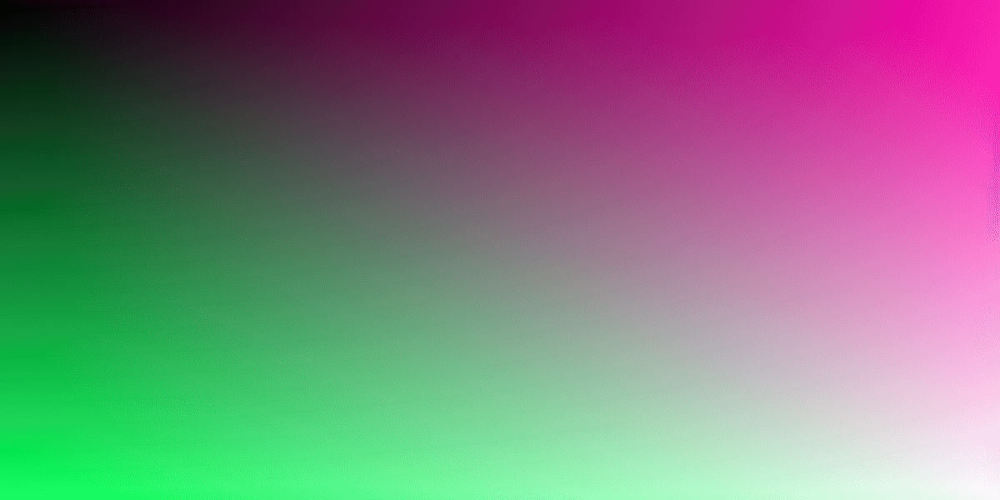
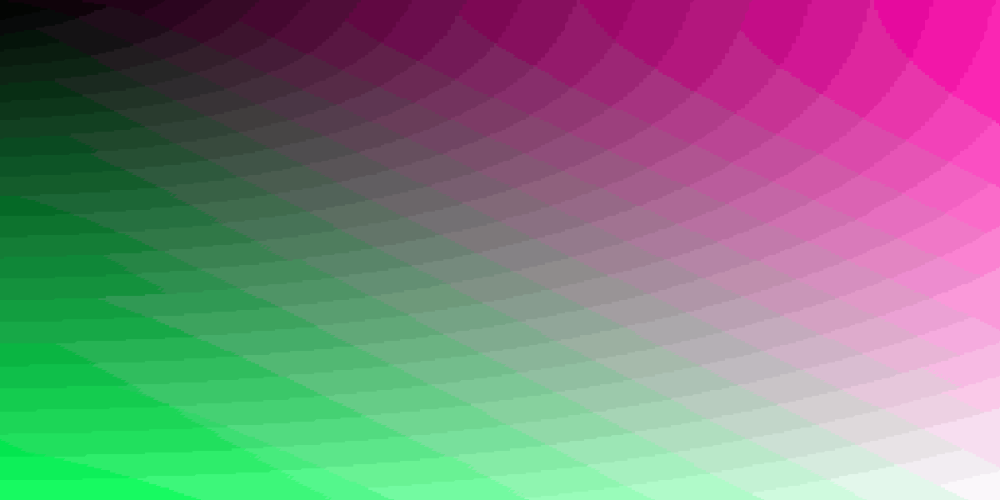

# Sixel processing, fidelity and memory review

Measured code: `2505a079fdc8c91582663aec55aea2dc44d982d9`, clean at capture,
Rust 1.99.1, optimized release builds, Intel Core Ultra 7 155H. The
[retained measurements](sixel-profile-2026-10-31.json) include executable and
fixture hashes, raw warm totals, resource usage, production diagnostics and
independent pixel checks. See [the reproduction method](sixel-method.md).

## Findings

Palette construction alone is not the principal cost in these cases. Rich
images spend substantially more time preparing colors, diffusing/mapping pixels
and writing Sixel bitplanes. A photograph that is enlarged also spends a large
fraction of preparation time in Lanczos fitting. Cached source decoding does
not eliminate these later stages when opening a new inspector size.

The retained production policy remains a shared 256-color Wu/Oklab palette with
continuous Floyd–Steinberg diffusion, plus exact indexing when terminal colors
already fit. The integrated optimization removes redundant RGB and index copies;
it does not lower resolution, remove diffusion or substitute a cheaper palette.
It consistently avoids those allocations, but does **not** demonstrate uniformly
lower render times. Do not describe the change as a universal speed improvement.

Direct Oklab input is a useful experimental alternative for high entropy. Its
measured win does not justify selecting it for every image. The benchmark exposes
it explicitly; ordinary application rendering keeps the reviewed policy.

## Cost by stage

Native output uses 120 × 36 terminal cells at 10 × 20 pixels/cell. The photo
fits to 720 × 720; the gradient and entropy fixtures fit to 1200 × 600. The
table shows medians of three process means, each with nineteen warm renders.
Columns are independently aggregated and need not sum to the total.

| Warm stage, ms | Gradient | Photograph | High entropy |
| --- | ---: | ---: | ---: |
| Source decode | 0 | 0 | 0 |
| Crop/matte/resize | 0.69 | 21.35 | 0.23 |
| RGB/output buffers | 0.70 | 0.23 | 0.16 |
| Exact-color check | 0.05 | 0.01 | 0.01 |
| Deduplication/Oklab preparation | 6.50 | 5.89 | 18.48 |
| Wu histogram, palette and lookup | 0.49 | 0.75 | 2.41 |
| Diffusion and index mapping | 11.15 | 8.66 | 21.83 |
| Protocol encoding | 15.59 | 17.62 | 57.06 |
| Total | 35.40 | 55.28 | 102.28 |

Cold decode medians from the separate three-process/two-render matrix were
3.92 ms for the gradient PNG, 1.43 ms for the photograph PNG and 0.63 ms for the
entropy PNG. These controlled decode sizes/compression characteristics are not
claims about arbitrary JPEGs or maximum-size publisher images.

The initial short entropy runs ranged widely: default warm totals were
132.7–206.4 ms and the copying control ranged 113.7–224.9 ms. The extended
control was added because those three individual samples cannot establish a
small speed improvement. Even the longer run is a normally scheduled desktop
experiment, not an isolated CPU or a confidence guarantee.

## Alternatives

These values are medians of three process means of nineteen warm renders, for
the same native entropy input. RSS is the median whole-process high-water mark.
CPU seconds include all twenty renders, fixture setup and reference export.

| Path | Warm render, ms | Peak RSS, MiB | Process user CPU, s |
| --- | ---: | ---: | ---: |
| Original copying Pipeline | 105.49 | 38.27 | 2.02 |
| Staged Wu/Oklab, dedup, reused buffers | 102.28 | 36.22 | 1.99 |
| Direct Wu/Oklab, diffusion | 75.46 | 25.31 | 1.55 |

Direct input reduced render time by about 26%, RSS by about 30% and process
user CPU by about 22% relative to the staged deduplicated path in this entropy
control. Color preparation fell from 18.48 to 3.18 ms and diffusion/mapping from
21.83 to 10.87 ms; encoding stayed near 57 ms. A plausible explanation is the
cost of deduplicating nearly unique pixels and indexed palette indirection
instead of contiguous Oklab pixels. This is a code-path inference, not a
hardware-counter measurement.

Offline counts of the fitted references support this distinction: entropy has
704,687 distinct RGB colors in 720,000 pixels (98%), versus 109,201 (15%) in
the gradient and 177,915 (34%) in the photo. These counts were obtained after
the timed runs; they are not an extra production pass or a ready admission rule.

The trade-off reverses on lower-entropy inputs. Gradient peak RSS was 17.46 MiB
with dedup versus 20.75 MiB direct; photograph RSS was 19.93 versus 21.07 MiB.
The photograph's warm total was 55.28 ms with dedup versus 57.00 ms direct,
while process CPU measurements favored direct slightly. That disagreement and
ordinary scheduling variability do not establish a general latency winner.

The matrix also compares two deliberately different quality/cost controls:

| Gradient path | Warm total, ms | Wire bytes | Mean Oklab error × 100 | Eight-pixel-neighborhood error × 100 |
| --- | ---: | ---: | ---: | ---: |
| Wu/Oklab with diffusion | 38.66 | 405,372 | 1.62 | 0.33 |
| Same palette, no diffusion | 23.49 | 71,077 | 1.28 | 1.06 |
| icy_sixel 0.1.3 RGB median-cut + RGB diffusion | 33.53 | 360,412 | 2.53 | 0.99 |

These are three-process/two-render matrix medians, separate from the extended
control. Disabling diffusion improves per-pixel PSNR (31.27 → 33.11 dB) but
visibly introduces broad bands, and worsens neighborhood color error. Smaller
output and better per-pixel PSNR therefore do not establish superior rendering.
The tested RGB median-cut path also loses substantial photographic and entropy
fidelity: photo mean Oklab error was 3.15 versus 1.30, and entropy error 18.06
versus 3.34. These observations concern this pinned implementation/path, not
every median-cut implementation or every image.

Full-resolution, independently decoded gradient outputs:

With diffusion:

Without diffusion:

## Fidelity and implementation decision

The main comparison contains 420 measured renders across fourteen scenarios,
five policies and three processes. Its 210 final outputs were independently
decoded, including native surfaces, inline partial strips, antialiased diagrams
and transparent content on light/dark mattes. All default/reference comparisons
matched both protocol bytes and decoded pixels; cold/warm hashes also matched.
The longer controls add 540 renders and retain the same default/reference wire.

Direct input matched decoded pixels in all 42 measured comparisons too, but
only 30 had identical protocol bytes. The differing transparency streams
did not change displayed pixels in this corpus. Different floating
histogram accumulation still provides no universal equivalence proof for other
inputs. A bounded image-classification/admission policy and a broader corpus
should precede any automatic direct/dedup switch.

The integrated buffer optimization borrows RGB through Palette's checked cast,
consumes Quantette's final index vector, and moves the small palette allocation.
It avoids 3N copied RGB bytes and N copied indexed bytes: approximately 2.75 MiB
of redundant live buffers for a 1200 × 600 rich image. The extended gradient
control measured RSS falling from 19.47 to 17.46 MiB; the entropy control fell
from 38.27 to 36.22 MiB. The photo RSS difference was small and overlapping,
consistent with other process phases determining its high-water mark.
Exact diagrams bypass this optimization and retain their existing colors.

The public Quantette stages use the same histogram, palette and diffusion APIs
as the original Pipeline. No dependency/version/feature, source budget, 256-color
limit, image resolution, matte ordering or protocol implementation changed.

## Application and existing benchmark checks

The real App workload reads the NASA photo from the offline image cache, loads
it in the Reader and opens the inspector through normal input. Nine inspector
deliveries across three processes measured a median 62.47 ms, range
56.08–66.39 ms. This includes command admission, worker scheduling, processing
and polling, excluding terminal drawing/presentation and network downloads.
This is a one-article fixture, not a measurement of a large-library frame.
The inspector reuses the source decoded for the inline image. Its actual
`:performance` rows are retained, with two worker jobs per sample window;
their n=2 percentiles should not be treated as a latency distribution study.

Encoding time is also distinct from transmission and terminal decoding. The
native entropy surface carries 3,476,717 bytes (3.32 MiB), versus 721,828 bytes
for the photo. Faster preparation does not remove the subsequent transfer or
terminal parsing cost. Those physical/display costs were not measured here.

The existing twelve-workload image benchmark also ran in three representative
and three stress processes. Representative native SVG preparation was 8.58 ms,
inline strip preparation 2.29 ms and cached bidirectional clipping/frame work
3.43 ms. Stress medians were 34.01, 13.59 and 6.83 ms respectively. These are
current checked references, not causal comparisons with historical reports
collected under different revisions or workloads.

`make check`, the explicit HTTP qualification and real Foot qualification passed.
The first Foot attempt failed its welcome-screen precondition before reaching
Sixel checks; a fresh full run passed images, scrolling, reopen/zoom, linked
pages, graphical formulas, content preservation and terminal restoration.

## Next experiments

Prioritize encoding and diffusion rather than reducing the small Wu palette
timer alone. Encoding currently scans palette planes and copies plane vectors
for icy_sixel; the effect of skipping empty planes or a borrowed upstream
encoder API needs independent wire/pixel tests and measurements. For rich input,
contiguous versus indexed Oklab diffusion warrants cache-locality profiling.
Neither proposal is counted as an achieved improvement here.

Before adding k-means, parallel quantization or an automatic image classifier,
measure the existing alternatives against more natural photographs, UI/text
screenshots, saturated gradients and alpha edges at multiple viewport sizes.
Preserve the exact diagram path and validate emitted colors after Sixel rounding.
